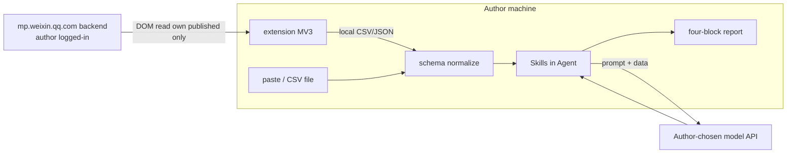
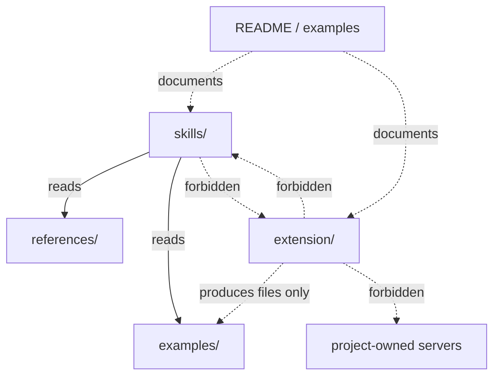

# Architecture Spine — gzh-quality-copilot

## Design Paradigm

**Local pipes-and-filters.** Stages run on the author's machine (or their chosen Agent host). Data flows one way:

`Ingress (extension | paste) → Normalize (schema) → Diagnose (Skills) → Report (four-block Markdown)`

There is **no** project-hosted application server, account system, or LLM. The Agent runtime and model provider are **outside** this repo's trust boundary.



## Invariants & Rules

### AD-1 — No project-hosted runtime `[ADOPTED]`

- **Binds:** all
- **Prevents:** one builder shipping a SaaS/API while another assumes local-only Skills
- **Rule:** This repository must not introduce a required backend, auth, or inference service for MVP. Skills execute inside the author's Agent; models are the author's.

### AD-2 — Extension is ingress-only (MV3) `[ADOPTED]`

- **Binds:** FR-5, FR-2
- **Prevents:** extension that scrapes others, uploads data, or embeds Skill logic
- **Rule:** Chrome extension **Manifest V3** only. It may read the author's logged-in WeChat MP backend pages for **own published** articles and write **local** CSV/JSON. It must not: proxy-login, publish, scrape other accounts, or upload to servers owned by this project. Popup UI per UX spine. `[ASSUMPTION: implementation language TypeScript]`

### AD-3 — Shared artifact schema; Skills ↛ extension `[ADOPTED]`

- **Binds:** FR-4, FR-5, FR-7
- **Prevents:** Skill that only works when extension is installed; dual incompatible CSV shapes
- **Rule:** Normative interchange gold sample lives at **`examples/articles.interchange.json`** (plus a CSV twin generated from it or documented as field-equivalent). Extension export and paste import MUST match that gold sample's field names and JSON types. **Primary format = JSON**; CSV is optional convenience with identical columns. Skills consume files/text only — they MUST NOT call extension APIs or require the extension at runtime. Paste remains a first-class path after launch; first public tag still requires a working extension (PRD FR-5).

### AD-4 — Diagnosis contracts are mandatory `[ADOPTED]`

- **Binds:** FR-6, FR-7, FR-10, FR-11, FR-12
- **Prevents:** free-form chat Skills that skip degradation / evidence
- **Rule:** Any Skill that claims "review" or "full report" MUST enforce: (1) article-count degradation table, (2) four-block output order 结论→因子→候选→实验, (3) evidence snippets or explicit 推测. The degradation table and four-block skeleton MUST be defined in a **single shared file** (e.g. `skills/_shared/contracts.md` or one orchestrator Skill) that every review Skill references — no divergent private copies. Packaging as 1 vs 3 Skill folders is Deferred, but shared contracts are not.

### AD-5 — references/ are summaries with provenance, never full text `[ADOPTED]`

- **Binds:** FR-8, FR-9
- **Prevents:** shipping scraped full articles; empty provenance pages
- **Rule:** Built-in track material under `references/` is human-annotated structure summaries with auditable source notes, **no third-party full text**. First ship: short-fiction track with ≥5 entries (PRD). Benchmark full text only via author paste.

### AD-6 — Dependency direction `[ADOPTED]`

- **Binds:** all packages in repo
- **Prevents:** cyclic coupling Skills ↔ extension; docs importing runtime secrets
- **Rule:** Allowed depends-on:



Skills may not import extension code. Extension may not embed Skill prompts as the only diagnosis path. **MVP: all track `references/` content lives only at repo-root `references/`** — per-Skill `references/` corpora are forbidden until a later AD lifts this.

### AD-7 — Privacy disclosure is part of the product surface `[ADOPTED]`

- **Binds:** FR-2, FR-14, UX README
- **Prevents:** implying "local export ⇒ data never leaves the machine"
- **Rule:** README must document three layers: local export; Skills on Agent; pasted content to **author-chosen** model API. The README permission checklist MUST be generated from or **verbatim-copied** from `extension/manifest.json` host/permissions — hand-written drift is a defect.

## Consistency Conventions

| Concern | Convention |
| --- | --- |
| Naming | Repo `gzh-quality-copilot`; Skills folders `skills/<job>/SKILL.md`; extension under `extension/` |
| Data formats | UTF-8 CSV and/or JSON; dates ISO-8601 when present; missing fields → explicit gap, never fabricated metrics |
| Report | Four H2/H3 blocks in fixed order; badges as literal `【低置信】` / `【推测】` in Markdown |
| Errors | Extension failures surface paste fallback copy; Skills refuse fine percentiles when count &lt;10 |
| Config | No project `.env` required for core path; Agent model keys stay in the Agent host |
| UX | Proof Desk tokens apply to extension HTML; README stays Markdown-only (UX final) |

## Stack

| Name | Version |
| --- | --- |
| Chrome Extensions platform | Manifest V3 (only supported; MV2 removed for current Chrome — verified 2026-10) |
| Extension UI | HTML/CSS/TS popup `[ASSUMPTION: TypeScript]` |
| Agent Skills | agentskills.io layout: `SKILL.md` + `references/` |
| Interchange | CSV / JSON (schema owned by `examples/` + docs) |
| LLM | Author Agent — out of repo |

## Structural Seed

```text
gzh-quality-copilot/
  README.md                 # install, privacy, bans, demo order
  LICENSE                   # required before public tag (SPDX TBD)
  skills/
    _shared/contracts.md    # degradation table + four-block skeleton (AD-4)
    */SKILL.md              # packages may split later; must cite _shared
  references/               # ONLY root location for track summaries (AD-6)
  examples/
    articles.interchange.json   # normative gold sample (AD-3)
    articles.interchange.csv    # optional twin
    sample-report.md
  extension/                # MV3; popup export
    manifest.json
    src/
```

Gold-sample fields (seed): `title`, `publish_time?`, `read_count`, `like_count`, `share_count?`, `wow_count?`, `url?`, `body?`.

## Capability → Architecture Map

| Capability / Area | Lives in | Governed by |
| --- | --- | --- |
| Install / README / bans / privacy | README.md | AD-7, UX EXPERIENCE |
| Own-account export | extension/ | AD-2, AD-3, AD-6 |
| Paste import | examples/ + Skill prompts | AD-3, AD-4 |
| Relative review + degradation | skills/ | AD-4 |
| Structure summaries | references/ | AD-5 |
| Title + experiments | skills/ | AD-4 |
| Four-block report | skills/ output | AD-4, UX sample-report |
| Dogfood / vs-chat demo | process (not code) | PRD §6.3 |

## Deferred

- Skill packaging: 1 orchestrator vs 3 packages — wait for agentskills best-practice pass (PRD §8.2)
- SPDX LICENSE id — choose before public tag (PRD FR-14); not an architecture fork
- Exact MP.weixin DOM selectors — owned by extension maintenance; paste path absorbs breakage
- Later: Web upload, paid heat APIs, multi-track references market, Side Panel vs popup (popup assumed)
- Hosting/CI publish to Chrome Web Store — optional; sideload OK for MVP dogfood
